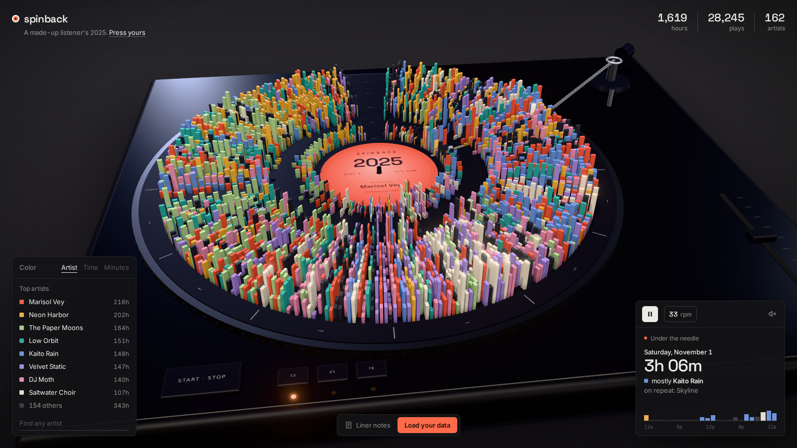
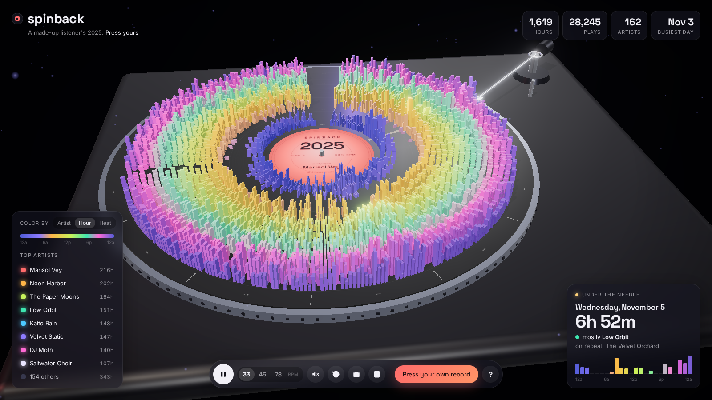
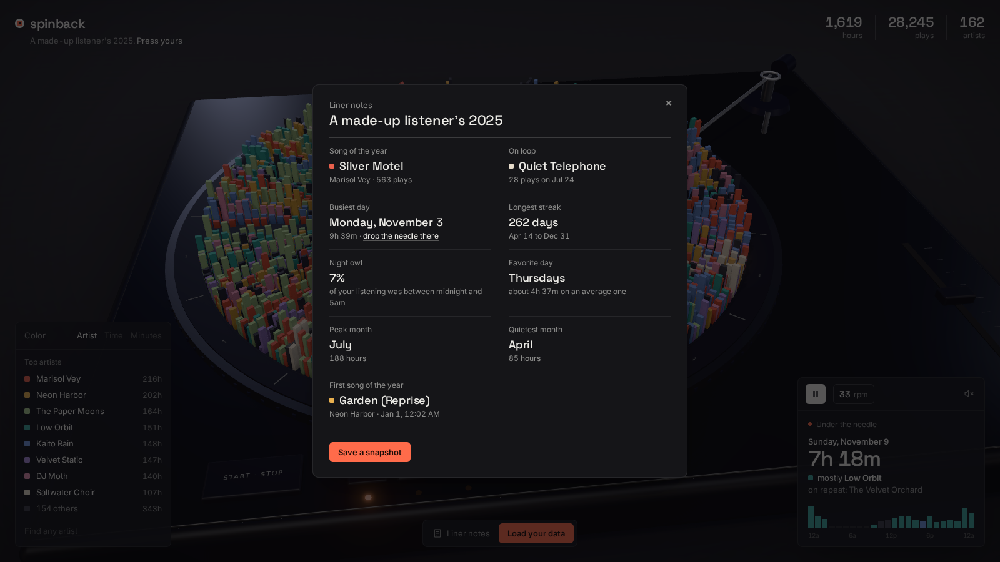

# Spinback

Your year of Spotify listening, pressed onto a spinning 3D record.

**Try it: https://peterlee1022.github.io/spinback/**



Every day of the year is a spoke on the disc and every hour is a groove ring, with midnight by the label and 11pm out at the rim. Bar height is how many minutes you listened in that hour, and the colour is whichever artist you played most in it. The tonearm reads the day passing under it, so leaving it spinning on a second monitor plays back your year one day at a time.

## Things to do

- Hover any bar to see what you were playing that hour, and click it to drop the needle on that day.
- Grab the record and drag it to scratch back and forth through the year. Give it a flick and it keeps spinning. Drag around the record or right-drag to orbit the camera instead.
- Click an artist in the legend to press a record of just them. Seasonal phases show up really clearly this way. The search box under the legend finds anyone else you listened to.
- Switch the colours between artist, hour of day and heat. Colouring by hour turns your daily routine into rings, and it is usually the calmer view for real data with lots of artists.
- Open the liner notes for your song of the year, longest streak, the song you put on loop, how much of a night owl you are and a few more.
- Save a snapshot of the record as a PNG to share.
- Switch between 33, 45 and 78 rpm, pause to lift the arm, and turn the sound on for crackle and scratching.
- Space pauses, and the left and right arrow keys step the needle one day at a time.
- Leave it alone for a bit and the camera starts drifting around the record, which makes it a nice thing to have open on a second monitor.





## Using your own data

1. Go to your [Spotify privacy settings](https://www.spotify.com/account/privacy/) and request your data. "Account data" covers the last year and takes about 5 days. "Extended streaming history" covers every year you have streamed and can take up to 30 days.
2. Drop the zip Spotify emails you onto the page. You can also drop the `StreamingHistory*.json` or `Streaming_History_Audio_*.json` files directly.

The quick "Account data" export covers the last year, which usually spans two calendar years, so it gets pressed as a rolling "Last 12 months" record. You can still switch to each calendar year from the tabs under the title.

Everything is parsed in the browser. Nothing gets uploaded anywhere. Until you load a file, the page shows a made-up listener.

## Running it

```
npm install
npm run dev
```

`npm test` runs the parser tests, and `npm run build` outputs a static site to `dist/` that can go on any static host. Pushes to `main` deploy to GitHub Pages.

Built with three.js and fflate.
