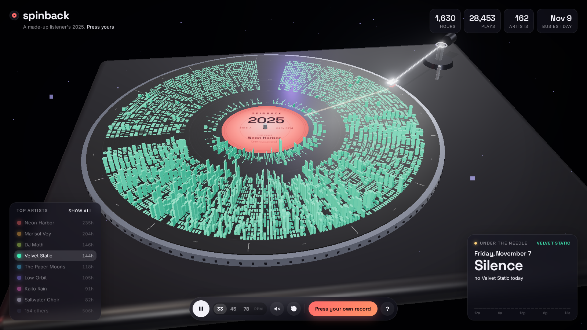

# Spinback

Your year of Spotify listening, pressed onto a spinning 3D record.


Every day of the year is a spoke on the disc and every hour is a groove ring, with midnight by the label and 11pm out at the rim. Bar height is how many minutes you listened in that hour, and the colour is whichever artist you played most in it. The tonearm reads the day passing under it, so leaving it spinning on a second monitor plays back your year one day at a time.

## Things to do

- Hover any bar to see what you were playing that hour, and click it to drop the needle on that day.
- Click an artist in the legend to press a record of just them. Seasonal phases show up really clearly this way.
- Switch between 33, 45 and 78 rpm, pause to lift the arm, and turn on the vinyl crackle if you like.
- Click "busiest day" to jump straight to it.



In solo view above, that artist's summer peak shows up as the tall stretch of bars.

## Using your own data

1. Go to your [Spotify privacy settings](https://www.spotify.com/account/privacy/) and request your data. "Account data" covers the last year and takes about 5 days. "Extended streaming history" covers every year you have streamed and can take up to 30 days.
2. Drop the zip Spotify emails you onto the page. You can also drop the `StreamingHistory*.json` or `Streaming_History_Audio_*.json` files directly.

Everything is parsed in the browser. Nothing gets uploaded anywhere. Until you load a file, the page shows a made-up listener.

## Running it

```
npm install
npm run dev
```

`npm run build` outputs a static site to `dist/` that can go on any static host.

Built with three.js and fflate.
